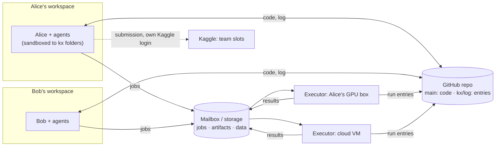

# kx for a team (design, not built)

One Kaggle team, several people, each with their own agents, one code repo. Nobody is the boss: there is no central
machine that holds the truth or gives orders. People trust each other's intentions, not each other's care: the design
guards against honest mistakes (a wrong protocol, unpushed code, a deleted file, an agent running a script it should
not), not against someone gaming it.

## Decisions

1. **Two kinds of machine.** A *workspace* is where a person and their agents think: read, write code, start runs,
   write findings, propose submissions. An *executor* runs jobs and nothing else. A solo setup is both, as today.
2. **Workspaces never run project code.** Training, evaluation, smoke tests, notebooks and building the project's
   environment (`uv sync` runs packages' build scripts) happen on executors. On a workspace, kx and the agents work
   only inside the kx folders.
3. **The ledger becomes a shared log in git.** Each person (on each machine) appends to their own file on a `kx/log`
   branch of the code repo; every workspace rebuilds its SQLite from all the files. Nobody edits anyone's entries.
4. **Shared, scarce things follow rules kept in the repo**, changed by review like code: the team's submission slots,
   the reference protocol, executors' budgets.

## Workspaces: confined, and running no project code

What kx does on a workspace, and what it refuses:

| | workspace | executor |
|---|---|---|
| kx commands, dashboard, git, agents | yes | the kx agent only |
| `kx exec` (a run) | sends it to an executor (`--on`, or the team's default) | runs it, in a sandbox |
| smoke tests, `evaluate.py`, score recomputation | as executor jobs | yes |
| the project's environment (`uv sync`) | never built | built per `uv.lock` |
| artifacts | read as data (JSON, CSV, parquet, images); never unpickled | written |
| Kaggle actions | the human's `--yes`, with their own login | never |

**Sandbox.** Workers (Claude, Codex) start inside bubblewrap (`bwrap`, no root needed): the competition folder and
its store read-write, the system and tools read-only, a private /tmp, an empty home except the harness's own login
(`~/.claude`, `~/.codex`) and `~/.config/kx`. Anything the agent runs, including a script it decides to try, sees
nothing else, so a mistake can at worst damage the competition folder, which git and the log recover. Network stays
open (APIs, git). The interactive agent in your own terminal is yours to sandbox (Claude Code's and Codex's own
modes); kx does not wrap it. Linux first (bwrap); macOS has `sandbox-exec`; Windows workspaces use WSL.

**Executors** also run each job sandboxed: the job's folder read-write, data and environment read-only, no home. That
protects the executor's owner from a teammate's bug, and keeps the mailbox login (Drive token) out of the job's reach.

## The shared log

- Branch `kx/log` (orphan) of the code repo, one file per writer: `log/<person>@<machine>.jsonl` and
  `log/exec-<name>.jsonl`. One writer per file, so merges never conflict.
- An entry: `{"id", "at", "by": "alice/codex-1", "machine", "kind", "ref", "data"}`. Kinds are what the ledger
  records today: run started / ended, score, note, tag, task added / claimed / done, finding, protocol, submission
  proposed / OK'd / sent, budget use. A correction is a new entry that points at the old one.
- kx appends locally at once and pushes with `kx sync` (and after each write when online). The SQLite ledger becomes
  a cache: each workspace indexes the new lines of every file, so kx stays fast offline and the dashboard is unchanged.
- **IDs carry their author**: `alice/r0012`, `alice/T3`; a bare `r0012` still means yours. No two people can mint
  the same id, and nobody needs a counter server.
- **A check on the branch** (a GitHub Action) rejects a push that edits or deletes past lines, or writes another
  writer's file. That catches the accident (a bad rebase, a hand edit), not a determined person, as agreed.
- Attribution comes from the GitHub account that pushes; entry signatures can come later if trust changes.

## Executors

- Listed in the repo (`comp.yaml` `hosts:`), with who owns each. The owner's agent config (on the executor, not in
  the repo) says whose jobs it takes and how many hours a day each person gets; jobs past that wait or are refused.
- **Code comes from the repo**, not from the submitter's laptop: the executor fetches the job's commit (read-only
  deploy key). A run from a commit nobody can fetch cannot be reproduced; it is allowed only as a probe, with its
  patch in the job, and is marked so everywhere.
- **Results are recorded by the executor**: it appends the run's entries to its own log file, so a run is recorded
  even when the laptop that launched it is closed. Its files go to shared storage, named by their hash; entries point
  at them.
- Transport: the mailbox already built (`kind: mailbox`, Drive), or ssh for machines on your Tailscale.

## Scores: how sure is a number

Each score shows where it comes from, so a mistake is visible before anyone builds on it:

1. **probe**: uncommitted code, or run outside an executor. Fine for exploring, never on the board by default.
2. **experiment**: a pushed commit, run on an executor, with its data version and `uv.lock`: anyone can rerun it.
3. **recomputed**: the run saved its predictions, and a separate small job recomputed the metric with the shared
   `evaluate.py`. Catches a wrong number written by hand or a buggy scoring path in a training script.
4. **replicated**: someone else's rerun agrees within noise (`kx compare`).

The board shows experiments and up by default. The reference protocol is team-wide: changing it is a reviewed
change of `comp.yaml`, and protocol fingerprints keep everything else comparable, as today.

## Submissions with shared slots

- The team's daily slots are in `comp.yaml`, with the sharing rule, e.g. `slots: {per_member: 1, open_after: "16:00 UTC"}`:
  each member has their share; unused ones free up for anyone later in the day. Optionally `needs_ok: 1`: another
  member OKs the proposal first.
- `kx submit R` adds a *proposal* entry (run, why, expect), checks the rule against the log and Kaggle's own count
  (the authority), and sends with the proposer's own Kaggle login once allowed. Two people racing for the last slot:
  Kaggle refuses the second, and kx says who got it.
- Agents still never pass `--yes`: their proposals wait for their own human.

## Tasks and findings

- Shared: any member's agent sees every open task. Claiming is an entry; the earliest claim in the merged log wins,
  and a claim with no activity for a day expires.
- Findings cite runs as evidence; others add "confirmed by" / "disputed by" entries instead of editing the finding.

## What stays as it is

The Python API (`kx.run`, `r.score`, ...), protocols and fingerprints, budgets, `--json` everywhere, the dashboard,
plain git for code. A person working alone keeps both roles on one machine and sees no difference except the
sandbox around workers.

## Data: lazy, and moved once

Three kinds of files travel between machines, and today each is moved eagerly and whole: the competition data
(enveda: 2.9 GB `train.parquet`), datasets runs derive from it (enveda's `data/derived/`, 3.4 GB, which every new host
receives because it sits in the data folder; ptcg's replay caches), and run outputs other runs start from (ptcg's
`latest.pt`, 196 MB, copied home on every sync whether anyone needs it). The rules:

1. **Everything that travels is a file named by its content** (sha256), in a per-machine cache
   (`~/.cache/kx/blobs/`, capped, least recently used goes first, never a file a running job holds). A *dataset* is a
   manifest `{path: {sha256, size}}` with a name and a version (the manifest's hash). A new version that changes one
   file moves one file; two datasets sharing files store them once.
2. **A run gets a file when it first asks for it**: `kx.data("train.parquet")`, `kx.dataset("features")`
   (a directory; one file of it with `kx.dataset("features", "part-007.parquet")`), `kx.output("alice/r0730",
   "latest.pt")` return local paths, fetching what is missing. `kx exec --needs ...` (or the job's previous runs: kx
   records what each one asked for) prefetches before the run starts, so a GPU does not wait on a download.
   `kx.data_dir()` keeps working and means "all of it", eagerly.
3. **From the nearest place that has it**: this machine's cache, then another executor that has it (over Tailscale),
   then shared storage, then Kaggle for competition files (a datacenter download, with a short-lived token from a
   workspace), and a workspace's home uplink only for what exists nowhere else.
4. **Uploaded only when someone needs it.** Outputs and derived datasets stay on the executor that made them; the log
   records their manifests and where they are. They go to shared storage when another machine asks for one, when a
   person pins it (`kx pin`), or before the executor would evict the only copy of something the log refers to
   (a submitted model, a dataset a protocol names). Copy-back brings home logs, metrics, scores and small files;
   the dashboard lists the big ones with their size and location, and `kx fetch alice/r0730 latest.pt` gets one.
5. **Derived data is a dataset, made by a run.** `r.dataset("features", path)` registers a directory as a new version
   with its provenance (run, commit, input versions). Nothing writes into the competition data folder any more, so
   its version means what it says, and a protocol can name the datasets it depends on.

Big single files cannot be fetched in part (a 2.9 GB parquet is moved whole the first time a machine asks).
Datasets written as shards make laziness finer; where FUSE works, an `rclone mount` with a disk cache can serve
parts of files on demand, but it is slow for random reads, so it is an option, not the default.

## Phases

1. **Roles and sandboxes.** *Built 2026-10-24.* `role: workspace | executor | both` in `~/.config/kx/machine.yaml`;
   workers in bwrap; workspaces send `kx exec` / `kx.run` to an executor (`default_host:`); jobs on ssh and mailbox
   executors in bwrap (data read-only but `derived/`, home hidden); hosts get Kaggle's files only, plus
   `kx exec --needs`; big outputs stay on the host until `kx fetch`. Until executors take jobs from a workspace
   (phase 3), the submission smoke test runs on the workspace, sandboxed.
2. **The log.** `kx/log` branch, per-writer files, SQLite as a cache, author-qualified ids, `kx sync` for the log,
   import of the current ledger as the first entries.
3. **Team executors.** Jobs from any member, code fetched from the repo, results recorded by the executor, per-person
   budgets.
4. **Slots and proposals.** The sharing rule, proposals and OKs, Kaggle's count as the authority.
5. **Recomputed scores.** Predictions saved by runs, a recompute job, provenance on the board.

Lazy data spans phases: on-demand copy-back (`kx fetch`) and `--needs` came with phase 1; the content-named cache,
`kx.data` / `kx.dataset` / `kx.output` and fetching from peers come with phase 3.

## Settled

- Code and log in a private GitHub repo; a GitHub Action checks the `kx/log` branch.
- Executors push their own log entries, with a token limited to `kx/log` (a GitHub ruleset). The alternative, results
  relayed by their owner's workspace, records nothing while that workspace is off.
- Workspaces do not load models for now.

## Open questions

- Storage for artifacts: one shared Drive folder (the mailbox), or a bucket (R2/S3) once files get large.
