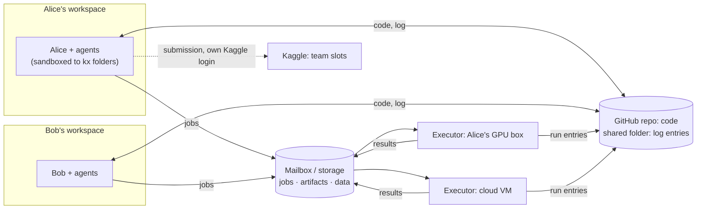

# kx for a team (design, not built)

One Kaggle team, several people, each with their own agents, one code repo. Nobody is the boss: there is no central
machine that holds the truth or gives orders. People trust each other's intentions, not each other's care: the design
guards against honest mistakes (a wrong protocol, unpushed code, a deleted file, an agent running a script it should
not), not against someone gaming it.

## Decisions

1. **Two kinds of machine.** A *workspace* is where a person and their agents think: read, write code, start runs,
   write findings, propose submissions. An *executor* runs jobs and nothing else. A solo setup is both, as today.
2. **Workspaces never run project code.** Training, evaluation, smoke tests, notebooks and building the project's
   environment (`uv sync` runs packages' build scripts) happen on executors. On a workspace, kx and the agents work
   only inside the kx folders.
3. **The ledger becomes a shared log.** Each person (on each machine) appends to their own file in a folder everyone
   reaches with rclone; every machine rebuilds its SQLite from all the files. Nobody edits anyone's entries.
4. **Shared, scarce things follow rules kept in the repo**, changed by review like code: the team's submission slots,
   the reference protocol, executors' budgets.

## Workspaces: confined, and running no project code

What kx does on a workspace, and what it refuses:

| | workspace | executor |
|---|---|---|
| kx commands, dashboard, git, agents | yes | the kx agent only |
| `kx exec` (a run) | sends it to an executor (`--on`, or the team's default) | runs it, in a sandbox |
| smoke tests, `evaluate.py`, score recomputation | as executor jobs | yes |
| the project's environment (`uv sync`) | never built | built per `uv.lock` |
| artifacts | read as data (JSON, CSV, parquet, images); never unpickled | written |
| Kaggle actions | the human's `--yes`, with their own login | never |

**Sandbox.** Workers (Claude, Codex) start inside bubblewrap (`bwrap`, no root needed): the competition folder and
its store read-write, the system and tools read-only, a private /tmp, an empty home except the harness's own login
(`~/.claude`, `~/.codex`) and `~/.config/kx`. Anything the agent runs, including a script it decides to try, sees
nothing else, so a mistake can at worst damage the competition folder, which git and the log recover. Network stays
open (APIs, git). The interactive agent in your own terminal is yours to sandbox (Claude Code's and Codex's own
modes); kx does not wrap it. Linux first (bwrap); macOS has `sandbox-exec`; Windows workspaces use WSL.

**Executors** also run each job sandboxed: the job's folder read-write, data and environment read-only, no home. That
protects the executor's owner from a teammate's bug, and keeps the mailbox login (Drive token) out of the job's reach.

## The shared log

*Built (phase 2), through a shared rclone folder rather than the `kx/log` git branch first planned: one mechanism
for every machine, including the ones without a GitHub login (rented boxes, the mailbox hosts' Drive).*

- One file per writer, `log/<user>@<machine>.jsonl`, in the store and in `<share>/<slug>/log/` (`share:` in
  machine.yaml: Google Drive, S3, sftp, anything rclone reaches). One writer per file, so nothing is ever merged.
- An entry is a change to a row of the ledger: `{"c", "at", "by", "u", "t", "op", "row" | "set" + "where"}`. `u` is
  random: an entry that comes twice (a log kept beside its shared copy, history moved to a new name) applies once. `c` is a
  logical clock (Lamport's): a change made after seeing another machine's entry replays after it whatever the wall
  clocks say. The SQLite file is a cache, the logs replayed in (c, at, log) order, so every machine that has the same
  logs has the same ledger. Logs that only grew are applied in place when their new entries replay after the cache's
  last one; otherwise the cache is rebuilt.
- **Logs only grow**: a sync never lets a shorter or different copy replace a log, here or in the shared folder. A
  machine that lost its store takes its own log back from the folder; what it wrote meanwhile is kept beside it as
  `<user>@<machine>+fork-<time>.jsonl`. Only complete lines go up, read under the lock, and a half line a crash left
  is cut off before anything is appended to it. Two stores under one name are refused (each log has one writer); a
  machine that changed its name keeps its old logs, and what it wrote under a name another machine also has moves to
  its new one.
- **IDs are a number and a name** (`r0012-fluent-sun`), not author-qualified: the number is the next one this machine
  knows of, the name a random one, so two machines can make the same number, not (but rarely) the same id. A bare
  `r12` means this machine's, and kx says when another machine has an r12 too. Two rows with the very same id: this
  machine's keeps it here, the other shows with its writer's suffix (`~ab12`), and the sync says so. From then on the
  logs name each by its full name (id and suffix), so a note one machine writes reaches the same run on all.
- **Owners carry their machine** (`alice@laptop`, `codex-1@gpubox`); of two claims made without seeing each other
  the earlier by the clock wins, a `done` / `wait` made under a claim that lost changes nothing, and the loser's
  `kx status` says it lost. A task branch whose task is not in this ledger yet is no task here (not this machine's
  task of that number).
- A Kaggle submission two machines took as external before seeing each other is one: the other id leads to it.
  A submission is charged when it is sent, under the lock, so two agents on one machine cannot both pass a cap.
- **Budgets count what pays for them**: the team's submission slots, a person's Kaggle GPU quota, tokens and paid
  hosts, a machine's own GPUs (`budgets.scope` overrides). Usage made elsewhere counts once it has synced.
- Run records (logs, curves, tables, submitted files) go as one archive per run, `records/<writer>/<run>.tar.gz`,
  sent when its files change.
- Not built from the plan: a check that rejects edits of past lines (the folder trusts whoever can write it), claims
  that expire after a day, attribution beyond the `user:` each machine gives itself.

## Executors

- Listed in the repo (`comp.yaml` `hosts:`), with who owns each. The owner's agent config (on the executor, not in
  the repo) says whose jobs it takes and how many hours a day each person gets; jobs past that wait or are refused.
- **Code comes from the repo**, not from the submitter's laptop: the executor fetches the job's commit (read-only
  deploy key). A run from a commit nobody can fetch cannot be reproduced; it is allowed only as a probe, with its
  patch in the job, and is marked so everywhere.
- **Results are recorded by the executor**: it appends the run's entries to its own log file, so a run is recorded
  even when the laptop that launched it is closed. Its files go to shared storage, named by their hash; entries point
  at them.
- Transport: the mailbox already built (`kind: mailbox`, Drive), or ssh for machines on your Tailscale.

## Scores: how sure is a number

Each score shows where it comes from, so a mistake is visible before anyone builds on it:

1. **probe**: uncommitted code, or run outside an executor. Fine for exploring, never on the board by default.
2. **experiment**: a pushed commit, run on an executor, with its data version and `uv.lock`: anyone can rerun it.
3. **recomputed**: the run saved its predictions, and a separate small job recomputed the metric with the shared
   `evaluate.py`. Catches a wrong number written by hand or a buggy scoring path in a training script.
4. **replicated**: someone else's rerun agrees within noise (`kx compare`).

The board shows experiments and up by default. The reference protocol is team-wide: changing it is a reviewed
change of `comp.yaml`, and protocol fingerprints keep everything else comparable, as today.

## Submissions with shared slots

- The team's daily slots are in `comp.yaml`, with the sharing rule, e.g. `slots: {per_member: 1, open_after: "16:00 UTC"}`:
  each member has their share; unused ones free up for anyone later in the day. Optionally `needs_ok: 1`: another
  member OKs the proposal first.
- `kx submit R` adds a *proposal* entry (run, why, expect), checks the rule against the log and Kaggle's own count
  (the authority), and sends with the proposer's own Kaggle login once allowed. Two people racing for the last slot:
  Kaggle refuses the second, and kx says who got it.
- Agents still never pass `--yes`: their proposals wait for their own human.

## Tasks and findings

- Shared: any member's agent sees every open task. Claiming is an entry; the earliest claim in the merged log wins,
  and a claim with no activity for a day expires.
- Findings cite runs as evidence; others add "confirmed by" / "disputed by" entries instead of editing the finding.

## What stays as it is

The Python API (`kx.run`, `r.score`, ...), protocols and fingerprints, budgets, `--json` everywhere, the dashboard,
plain git for code. A person working alone keeps both roles on one machine and sees no difference except the
sandbox around workers.

## Data: lazy, and moved once

Three kinds of files travel between machines, and today each is moved eagerly and whole: the competition data
(enveda: 2.9 GB `train.parquet`), datasets runs derive from it (enveda's `data/derived/`, 3.4 GB, which every new host
receives because it sits in the data folder; ptcg's replay caches), and run outputs other runs start from (ptcg's
`latest.pt`, 196 MB, copied home on every sync whether anyone needs it). The rules:

1. **Everything that travels is a file named by its content** (sha256), in a per-machine cache
   (`~/.cache/kx/blobs/`, capped, least recently used goes first, never a file a running job holds). A *dataset* is a
   manifest `{path: {sha256, size}}` with a name and a version (the manifest's hash). A new version that changes one
   file moves one file; two datasets sharing files store them once.
2. **A run gets a file when it first asks for it**: `kx.data("train.parquet")`, `kx.dataset("features")`
   (a directory; one file of it with `kx.dataset("features", "part-007.parquet")`), `kx.output("alice/r0730",
   "latest.pt")` return local paths, fetching what is missing. `kx exec --needs ...` (or the job's previous runs: kx
   records what each one asked for) prefetches before the run starts, so a GPU does not wait on a download.
   `kx.data_dir()` keeps working and means "all of it", eagerly.
3. **From the nearest place that has it**: this machine's cache, then another executor that has it (over Tailscale),
   then shared storage, then Kaggle for competition files (a datacenter download, with a short-lived token from a
   workspace), and a workspace's home uplink only for what exists nowhere else.
4. **Uploaded only when someone needs it.** Outputs and derived datasets stay on the executor that made them; the log
   records their manifests and where they are. They go to shared storage when another machine asks for one, when a
   person pins it (`kx pin`), or before the executor would evict the only copy of something the log refers to
   (a submitted model, a dataset a protocol names). Copy-back brings home logs, metrics, scores and small files;
   the dashboard lists the big ones with their size and location, and `kx fetch alice/r0730 latest.pt` gets one.
5. **Derived data is a dataset, made by a run.** `r.dataset("features", path)` registers a directory as a new version
   with its provenance (run, commit, input versions). Nothing writes into the competition data folder any more, so
   its version means what it says, and a protocol can name the datasets it depends on.

Big single files cannot be fetched in part (a 2.9 GB parquet is moved whole the first time a machine asks).
Datasets written as shards make laziness finer; where FUSE works, an `rclone mount` with a disk cache can serve
parts of files on demand, but it is slow for random reads, so it is an option, not the default.

## Phases

1. **Roles and sandboxes.** *Built 2026-10-24.* `role: workspace | executor | both` in `~/.config/kx/machine.yaml`;
   workers in bwrap; workspaces send `kx exec` / `kx.run` to an executor (`default_host:`); jobs on ssh and mailbox
   executors in bwrap (data read-only but `derived/`, home hidden); hosts get Kaggle's files only, plus
   `kx exec --needs`; big outputs stay on the host until `kx fetch`. Until executors take jobs from a workspace
   (phase 3), the submission smoke test runs on the workspace, sandboxed.
2. **The log.** *Built 2026-10-24* (see The shared log: an rclone folder, not a git branch). Per-writer files,
   SQLite as a cache, ids of a number and a name, owners and budgets per machine and person, `kx sync`, `kx import`
   of the old ledger as the first entries, `kx export`.
3. **Team executors.** Jobs from any member, code fetched from the repo, results recorded by the executor, per-person
   budgets.
4. **Slots and proposals.** The sharing rule, proposals and OKs, Kaggle's count as the authority.
5. **Recomputed scores.** Predictions saved by runs, a recompute job, provenance on the board.

Lazy data spans phases: on-demand copy-back (`kx fetch`) and `--needs` came with phase 1; the content-named cache,
`kx.data` / `kx.dataset` / `kx.output` and fetching from peers come with phase 3.

## Settled

- Code in a private GitHub repo; the log in a shared rclone folder (phase 2 as built).
- Executors write their own log entries (phase 3), to their own file in the shared folder. The alternative, results
  relayed by their owner's workspace, records nothing while that workspace is off.
- Workspaces do not load models for now.

## Open questions

- Storage for artifacts: one shared Drive folder (the mailbox), or a bucket (R2/S3) once files get large.
