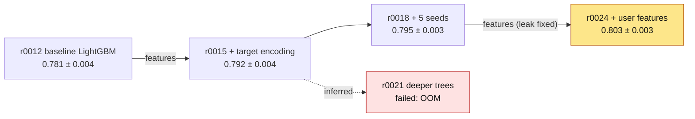
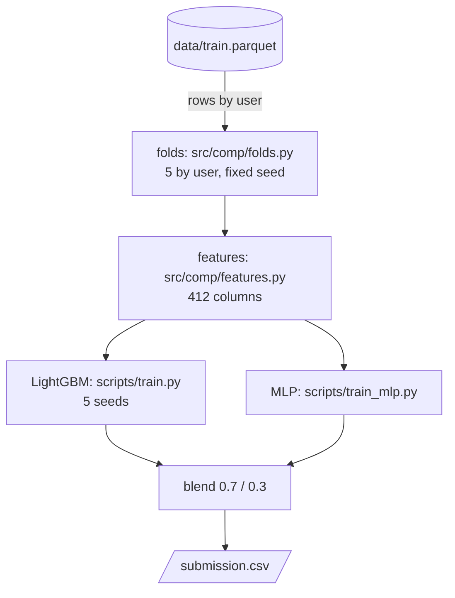
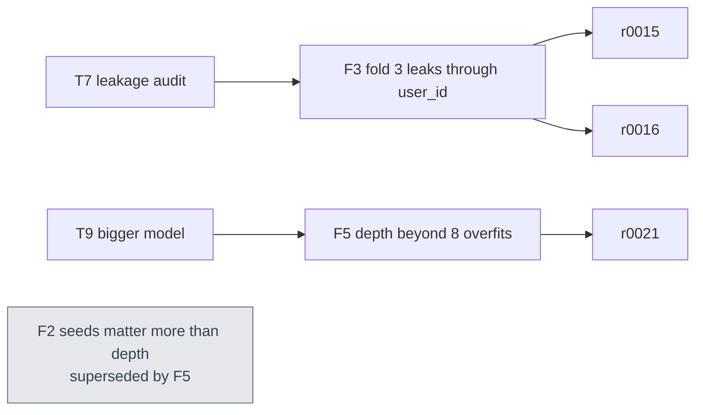
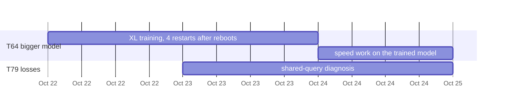

# Mermaid patterns for kx explanations

Mermaid renders in GitHub, most Markdown viewers and many terminals. Keep labels short and quoted (`A["..."]`):
unquoted parentheses, brackets, `#` and `;` break the parser. One idea per diagram.

## Lineage: how we got here

Runs oldest first, left to right. A node: the run id, what it changed, its score under the reference protocol. An
edge: the change, when it is not in the node. Failed runs and dead ends are styled apart; inferred links are dashed.

Many runs: keep the main line, and collapse side branches into one node (`side["6 speed runs, no change in
score"]`).

## Pipeline: how it works

From the code at the run's commit. Nodes are steps with the file that does them; edges carry what flows.

## Learning map: what we know and why

Tasks lead to findings; findings rest on runs. Withdrawn or superseded findings are dead ends.

## Timeline: where the time went

When the person asks about effort or pace. `gantt` dates come from runs' `created`/`finished` and tasks' notes.

